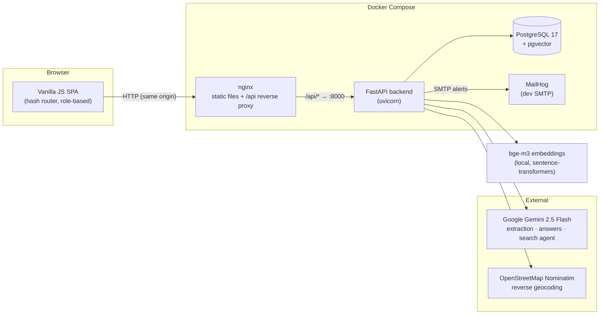
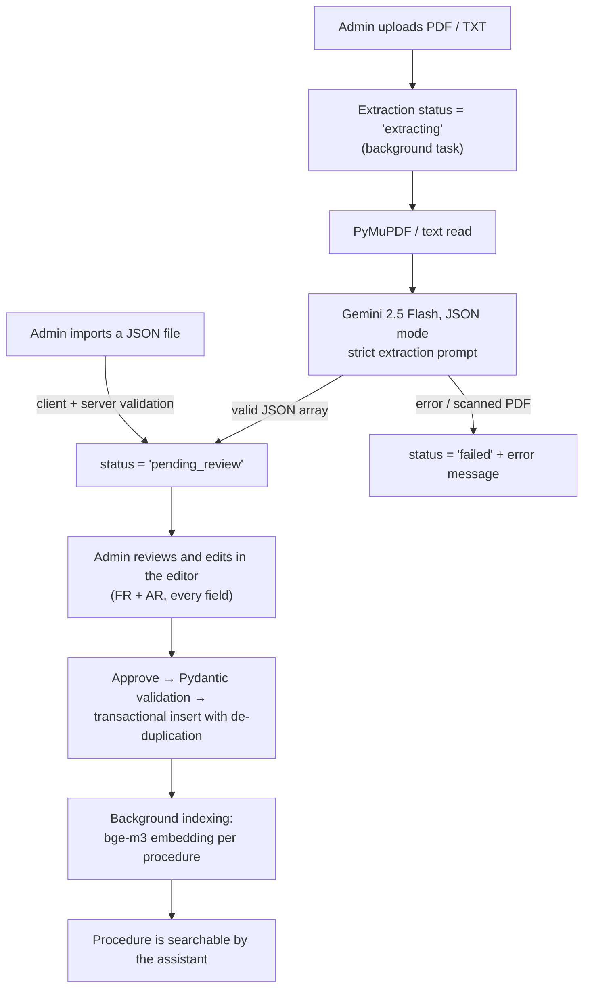
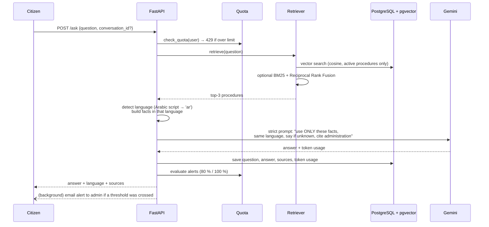
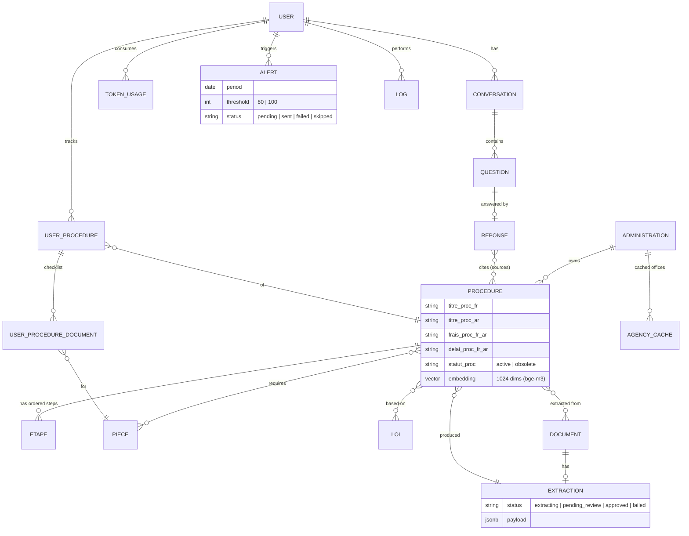

# Ijraia — Bilingual AI Assistant for Moroccan Administrative Procedures

> Ask a question in **French or Arabic** — get an answer grounded **only** in official procedures, with its sources, then track your file piece by piece and find the nearest office.

Ijraia is a full-stack **Retrieval-Augmented Generation (RAG)** platform. It turns unstructured official documents (PDF / TXT) into a structured, bilingual knowledge base of administrative procedures, and exposes that knowledge to citizens through a conversational assistant that refuses to invent information.

It has two faces:

- **Citizen space**: a chat assistant, a personal tracker for each procedure (checklist of required documents with notes), and an AI agent that finds the nearest offices of the competent administration.
- **Admin console**: an ingestion pipeline with mandatory human review (LLM extraction → JSON editor → approval → indexing), a catalogue of procedures and administrations, user and token-usage analytics, daily quotas with email alerts, an audit log, and cache management.

---

## Table of contents

1. [The problem](#1-the-problem)
2. [Key features](#2-key-features)
3. [Architecture](#3-architecture)
4. [Tech stack](#4-tech-stack)
5. [How the RAG pipeline works](#5-how-the-rag-pipeline-works)
6. [Engineering decisions and why](#6-engineering-decisions-and-why)
7. [Evaluation and results](#7-evaluation-and-results)
8. [Getting started](#8-getting-started)
9. [Configuration reference](#9-configuration-reference)
10. [User guide — Citizen](#10-user-guide--citizen)
11. [User guide — Administrator](#11-user-guide--administrator)
12. [API reference](#12-api-reference)
13. [Data model](#13-data-model)
14. [Project structure](#14-project-structure)
15. [Security](#15-security)
16. [Ragas Evaluation](#16-ragas-evaluation)

---

## 1. The problem

Completing an administrative procedure in Morocco usually means answering the same questions again and again: *Which administration handles this? Which documents do I need? How much does it cost? How long does it take? Where is the nearest office?*

The information exists, but it is:

- **scattered** across portals, PDFs and circulars from many administrations;
- **bilingual**: some sources are in Arabic, others in French, and citizens ask in either language;
- **unforgiving**: a wrong document list or a wrong fee costs a citizen a wasted trip.

A general-purpose chatbot is not acceptable here, because it **hallucinates** plausible but false fees, delays and documents. The design goal of Ijraia is therefore:

> **Answer only from verified official data, say "I don't know" when the data isn't there, cite the source, and keep a human in the loop for every piece of data that enters the system.**

---

## 2. Key features

### 👤 Citizen

| Feature | Description |
|---|---|
| **Account** | Self-registration (last name, first name, username, optional phone, email, password) and login. The session is held in an `HttpOnly` cookie. |
| **Bilingual AI assistant** | Ask in French or Arabic; the language is detected automatically and the answer comes back in the same language. Answers are rendered as Markdown (sanitized) with per-message right-to-left / left-to-right direction. |
| **Grounded answers with sources** | Every answer lists the procedures it was built from (title + administration). If no procedure matches, the assistant says so instead of guessing. |
| **Conversation history** | Conversations are saved, titled automatically from the first question, listed in the sidebar, and can be reopened or deleted. |
| **"Follow" a procedure** | One click on a source turns it into a personal file, in the language of the conversation. |
| **My procedures (tracker)** | One card per tracked procedure: progress bar, checklist of required documents, a free-text note per document (receipt number, counter…), and the ordered steps. The file switches to *completed* automatically when every document is checked. |
| **Obsolescence warnings** | If an administration withdraws a procedure, citizens who track it keep their checklist and see a warning. |
| **Nearest offices (AI agent)** | Finds the offices of the competent administration near you, using browser geolocation, or a list of 8 major cities as a fallback. Results show whether an **official source** was found, and whether they came from the cache. |
| **Daily usage meter** | A progress bar shows the day's token consumption, with a warning at 80 % and a clear message when the daily limit is reached. |

### 🛠️ Administrator

| Feature | Description |
|---|---|
| **Dashboard** | Totals (documents, procedures, documents required, steps, administrations), extractions by status, top 10 administrations, daily activity, and live **indexing progress** with an ETA. Every chart has a "table" twin for accessibility. |
| **Document ingestion** | Upload a PDF or TXT file (≤ 10 MB). Gemini extracts every procedure in the background into a **bilingual FR/AR JSON** structure. |
| **JSON import** | Import an already structured JSON file. It is validated in the browser **before** upload and again on the server (Pydantic). |
| **Human review editor** | Review and edit every extracted field (title, description, administration, documents, steps, laws, fee, delay) in both languages before anything reaches the database. Unsaved-changes guard, per-field error highlighting from server validation errors, pagination for large extractions. |
| **Approval → indexing** | Approval writes the procedures transactionally (with de-duplication), then embeddings are computed in a background job whose progress is shown in the dashboard. |
| **Procedures catalogue** | Search by title or administration, expand to see documents and steps. A second view, **"Documents required"**, ranks documents by how often they appear across procedures. |
| **Archive vs. delete** | *Mark obsolete* (recommended) removes a procedure from the assistant's answers but keeps it for citizens who track it. *Delete* is refused by the server while any citizen tracks the procedure. |
| **Administrations** | Fill in addresses and official websites in place (the website is used by the office-search agent to recognize official sources). Duplicate names are rejected. |
| **Users** | Read-only list of accounts with tracked procedures, conversations and lifetime tokens, a chart of the top 10 consumers over 30 days, and a detail page with token usage per feature. |
| **Quotas and alerts** | Daily token limit per citizen; alerts at 80 % and 100 %, sent by email in the background; alert history with resend and a test-email button. |
| **Audit log** | Read-only trail of every sensitive action (login, failed login, registration, upload, approval, deletion, obsolescence…) with IP, method, path and user agent. Filter by action or user. |
| **Office-search cache** | Inspect cached results (hits, expiry), purge one entry, the expired entries, or everything. Shows the number of AI searches saved. |

---

## 3. Architecture



- The frontend and the API are served from the **same origin** through nginx (`/api/` is proxied to the backend), so the session cookie works without any cross-origin configuration.
- The embedding model runs **locally** inside the backend container. Only text generation goes to Gemini.
- Long tasks (LLM extraction, embedding, email sending) run in **background tasks / threads**, so no HTTP request waits for them.

---

## 4. Tech stack

### Backend

| Layer | Technology | Role |
|---|---|---|
| Web framework | **FastAPI** + **Uvicorn** | REST API, dependency injection for auth/DB, background tasks |
| Validation | **Pydantic v2** | Request/response schemas, strict validation of bilingual extraction payloads |
| ORM | **SQLAlchemy 2.0** (typed `Mapped` models) | Data model, relationships, PostgreSQL upserts (`ON CONFLICT`) |
| Database | **PostgreSQL 17** + **pgvector** | Relational data, `JSONB` payloads, 1024-dim vectors with cosine distance |
| LLM | **Google Gemini 2.5 Flash** (`google-genai`) | Structured extraction (JSON mode), grounded answers, web search agent (Google Search grounding) |
| Embeddings | **BAAI/bge-m3** via **sentence-transformers** | Multilingual dense embeddings (Arabic + French in the same vector space) |
| Keyword search | Custom **BM25** (pure Python) | Exact-term retrieval with Arabic and French normalization |
| PDF parsing | **PyMuPDF** | Text extraction from PDF documents |
| Auth | **python-jose** (JWT HS256), **passlib/bcrypt** | Signed tokens in an HttpOnly cookie, password hashing |
| Rate limiting | **SlowAPI** | Brute-force protection on login and registration |
| Geocoding | **OpenStreetMap Nominatim** | Coordinates → city, cached in memory |
| Email | **smtplib** (+ **MailHog** in dev, any SMTP relay in prod) | Quota alerts |
| Evaluation | **Ragas 0.4**, an OpenAI-compatible LLM judge (DeepSeek) | Offline RAG quality metrics |

### Frontend

| Technology | Role |
|---|---|
| **Vanilla JavaScript (ES5, IIFE modules)** | No framework and no build step: the app is a set of plain files served by nginx |
| **Custom hash router** | Role-based routes (`admin` / `citizen` / guest), navigation guard for unsaved changes |
| **Hand-written SVG charts** | Responsive, dependency-free charts with a validated, color-blind-safe palette |
| **marked** + **DOMPurify** (cdnjs) | Markdown rendering of the assistant's answers, with XSS sanitization |
| **CSS (custom properties, logical properties)** | One stylesheet; the layout mirrors correctly in Arabic (RTL) |
| **Mock backend** (`js/mock.js`) | In-memory fake API to run the UI without the backend (`USE_MOCK: true`) |

### Infrastructure

**Docker** and **Docker Compose** (4 services: `db`, `backend`, `frontend`, `mailhog`), **nginx:alpine**, **python:3.12-slim**, the `pgvector/pgvector:pg17` image, and persistent volumes for the database and the Hugging Face model cache.

---

## 5. How the RAG pipeline works

### 5.1 Ingestion (admin side, human in the loop)



The extraction prompt makes the LLM produce, for every procedure: title, description, administration, documents required, ordered steps, laws, fee and delay, **each one as a `{ "fr": …, "ar": … }` pair**. The rules in the prompt are explicit: copy the source text verbatim, translate with official Moroccan administrative terminology (e.g. « الشهادة السلبية » = « certificat négatif »), keep numbers and legal references identical in both languages, and use `null` instead of guessing.

### 5.2 Question answering (citizen side)



Three retrieval modes are implemented and can be switched with one environment variable (`RETRIEVAL_MODE`):

| Mode | How it works | Strength |
|---|---|---|
| `vector` | bge-m3 embedding of the question, cosine distance in pgvector | Understands meaning and paraphrases, across languages |
| `keyword` | BM25 over an in-memory index (title weighted ×3), with Arabic/French normalization | Exact names, acronyms (CNSS, CNOPS), legal references |
| `hybrid` | Both lists fused with **Reciprocal Rank Fusion** (k = 60) | Combines both without comparing incompatible score scales |

**The deployed configuration uses `vector`**: this choice comes from the measurements in [section 7](#7-evaluation-and-results).

### 5.3 Nearest-office agent

1. Browser geolocation (10 s timeout), or a city picked from a fallback list.
2. Coordinates are rounded to about 1 km and reverse-geocoded with Nominatim (LRU cache of 5 000 entries; failures are never cached).
3. The city name is normalized (`"Préfecture de Casablanca"` → `casablanca`) and the cache is checked for `(administration, city)`.
4. On a cache miss, Gemini runs with **Google Search grounding**, with priority given to the administration's official website. The grounding URLs are followed to their real domain to decide whether an **official source** was found.
5. Non-empty results are cached for 30 days (an atomic upsert, so concurrent searches never create duplicates).

---

## 6. Engineering decisions and why

This section explains the reasoning behind the main design choices: the problem each one solves and the trade-off accepted.

### Data quality and trust

| Decision | Problem it solves |
|---|---|
| **Mandatory human review between extraction and publication** | LLM extraction is fast but fallible. Nothing generated by the model reaches citizens until an administrator has reviewed and approved it. Extraction status moves through `extracting → pending_review → approved / failed`. |
| **Structured, bilingual storage (`*_fr` / `*_ar` columns)** instead of raw text chunks | Procedures have a natural structure (documents, steps, fee, delay). Storing it as structured data enables the checklist tracker, the "documents required" analytics and exact answers to "how much does it cost?", which a pile of text chunks cannot provide. |
| **Translate once, at ingestion time** | Translating at question time would cost tokens on every request and produce inconsistent wording. Translating once, with official terminology, under human review, gives stable and verifiable text in both languages. |
| **Strict grounding prompt** ("use ONLY the facts, never invent, say when you don't know") | Hallucination is the main risk in this domain. The evaluation confirms the effect: 100 % correct refusals on out-of-scope questions (§7). |
| **"Obsolete" status instead of deletion** | When a procedure is withdrawn, deleting it would break the files of citizens who track it. Marking it obsolete removes it from retrieval (`statut_proc = 'active'` filter) while preserving their history. The server **refuses** a hard delete while a procedure is tracked. |
| **De-duplication on approval** (same FR title + same administration), and administrations / documents matched on FR **or** AR names | The LLM phrases translations slightly differently from one document to another. Matching on either language avoids creating near-duplicate administrations. |
| **Validation in the browser and again on the server** for JSON imports | Instant feedback for the admin, but the server never trusts the client: Pydantic rejects any non-bilingual or malformed payload before it touches the database. |

### Retrieval

| Decision | Problem it solves |
|---|---|
| **bge-m3 embeddings** | A single multilingual model puts Arabic and French in the same vector space, so a question in Arabic finds a procedure written in French. The embedded text combines both languages, as well as steps and documents. |
| **Run embeddings locally** | No per-call cost, no data sent out for indexing, and the indexed corpus does not depend on an external API being available. |
| **pgvector inside PostgreSQL** instead of a separate vector database | One database for relational data and vectors means one backup, transactional consistency, and status filters (`active`) applied in the same SQL query. Enough for a corpus of thousands of procedures. |
| **BM25 written from scratch, with Arabic normalization** (alef/ya/ta marbuta forms, diacritics, definite-article stripping, Arabic-Indic digits) | Off-the-shelf BM25 tokenizers handle Arabic poorly. The corpus is small, so an in-memory index with a 5-minute TTL is simpler and faster than a search engine. |
| **Reciprocal Rank Fusion** for the hybrid mode | Cosine similarities and BM25 scores live on incompatible scales. RRF uses only ranks, so no score normalization or tuning is needed. |
| **Retrieval mode chosen by measurement, not by assumption** | Hybrid search is often assumed to be better. Measured on a 149-question dataset, vector search was better here (88.6 % vs 83.2 % Hit@3), so `vector` is the deployed mode. Hybrid stays available behind a flag (§7). |
| **Re-check the status after retrieval** and fetch `top_k + 5` candidates | The BM25 index can be a few minutes old. Re-checking ensures that a procedure marked obsolete one minute ago is never served. |

### Cost control and reliability

| Decision | Problem it solves |
|---|---|
| **Daily token quota per citizen** (admins exempt), computed in **Africa/Casablanca time** | Protects the LLM budget against abuse. The quota is checked *before* any Gemini call (HTTP 429). "Today" is the citizen's day, whatever the container's time zone. |
| **Alerts deduplicated in the database** (unique constraint on user + day + threshold, `ON CONFLICT DO NOTHING`) | Even with concurrent requests, each threshold triggers exactly one alert. If 80 % and 100 % are crossed at once, only the 100 % email is sent and the other is marked *skipped*. |
| **Emails sent after commit, in a background thread** | An SMTP outage never slows down or breaks a citizen's request. Failures are recorded on the alert and can be resent from the console. |
| **Office-search cache (cache-aside, 30-day TTL)** | The agent costs 5–15 seconds and tokens per search. Office addresses rarely change, so citizens of the same city reuse one result. Empty results are not cached. Admins can force a refresh. |
| **Every token recorded per feature** (`chat`, `extraction`, `agencies`) | Makes it possible to see who consumes what, and which feature costs the most. |
| **Resumable indexing** | Each embedding is committed on its own, so a failure affects one procedure only. Procedures left without an embedding (for example after a restart) are picked up again at startup. A lock prevents two indexing runs at the same time, and the loop also picks up procedures approved during a run. |
| **Long tasks in the background** (extraction, indexing) with polling in the UI | Uploading a 10 MB PDF returns immediately. The UI polls every 3 seconds and shows the status. |

### Security

| Decision | Problem it solves |
|---|---|
| **JWT in an `HttpOnly`, `SameSite=Lax` cookie**; nothing in `localStorage` | JavaScript (and therefore an XSS payload) can never read the token. The frontend learns who is logged in only through `GET /citizen/me`. |
| **Authorization enforced on the server** (`require_admin`, ownership checks on every conversation / tracked item) | The role-based router in the frontend is for user experience only. Security is decided by the API. |
| **Rate limits**: login 5/min, registration 3/hour per IP | Mitigates credential stuffing and mass account creation. |
| **Generic login error** ("Identifiants incorrects") | Does not reveal whether a username exists. |
| **Password limited to 8–72 bytes** | bcrypt silently ignores anything after 72 bytes. Accepting longer passwords would suggest a strength that does not exist. |
| **Registration only creates citizens** | No user can grant themselves the admin role. |
| **Markdown sanitized with DOMPurify** | LLM output is untrusted content. |
| **Append-only audit log** with IP / user agent | Every sensitive action can be traced, and the log cannot be modified from the application. |

### Frontend

| Decision | Problem it solves |
|---|---|
| **No framework, no build step** | Zero toolchain to maintain. The app is served as static files, and every behavior is readable in plain JS. |
| **Hand-written SVG charts** | No heavy chart library. Text stays sharp at every size, every chart has a table equivalent, and status colors are always paired with an icon and a label. |
| **Per-message language and direction** | One conversation can mix Arabic and French. Each bubble and each tracked card takes its own language and direction (`dir`), instead of one direction for the whole screen. |
| **Optimistic checkbox with rollback** | Ticking a document updates the UI immediately. If the save fails, the checkbox reverts and the error is shown, so the progress bar always matches what is saved. |
| **Geolocation fallback to a city list** | Browsers block geolocation on plain HTTP outside `localhost`. Without the fallback, the feature would silently not work on such installations. |
| **Mock mode** | The whole UI can be demoed or developed without the backend, the database or API keys. |

---

## 7. Evaluation and results

RAG quality was **measured**, not assumed. The `backend/evaluation/` folder contains a reproducible pipeline split into independent steps, so the Gemini answers are generated (and paid for) once and can be re-scored as often as needed:

```
run_rag2.py   → runs the real pipeline on a dataset, saves retrieved procedures, facts, answers, timings, tokens
run_ragas.py  → scores a saved run with Ragas + an LLM judge (resumable, cost-tracked, one judge per file)
quick_stats.py→ retrieval metrics (Hit@k, MRR) per language and category
compare_runs.py → question-by-question comparison of two runs + exact sign test (McNemar)
merge_runs.py → merges partial runs and refuses to mix incompatible setups
```

### Dataset

`synthetic_v1.json`: **164 questions**, 87 in French and 77 in Arabic, each linked to its expected procedure(s) and a reference answer.

| Category | # | What it tests |
|---|---|---|
| situation | 83 | Real-life situations ("I want to run in the municipal elections, which document…") |
| factual | 21 | Direct questions about a procedure |
| no_answer | 15 | Questions with **no** answer in the database (the assistant must refuse) |
| fees_delay | 13 | Cost and processing time |
| documents | 11 | Documents required |
| ambiguous | 11 | Under-specified questions |
| user_style | 10 | Informal phrasing, typos |

### Retrieval: which mode to deploy?

Measured on the 149 answerable questions (`evaluation/runs/retrieval_*_v2.json`):

| Mode | Hit@1 | **Hit@3** (what Gemini receives) | Hit@5 | MRR |
|---|---|---|---|---|
| **Vector (bge-m3)** | **67.1 %** | **88.6 %** | **92.6 %** | **0.775** |
| Hybrid (RRF) | 62.4 % | 83.2 % | 88.6 % | 0.736 |
| Keyword (BM25) | 51.0 % | 69.1 % | 74.5 % | 0.606 |

- Vector search is clearly better than BM25 (sign test **p < 0.001**). It is equally good in Arabic (89.9 % Hit@3) and French (87.5 %).
- Hybrid search was **not** better than vector search on this corpus. The difference (17 questions found only by vector, 9 found only by hybrid) is not statistically significant (p = 0.169), and fusion adds noise when one retriever is much weaker.
- **Decision:** deploy `RETRIEVAL_MODE=vector` and keep hybrid behind a flag for future corpora with more acronyms and legal references.

### Answer quality (Ragas, vector mode, top-3)

164 questions scored by an LLM judge (DeepSeek, temperature 0, Ragas 0.4.3):

| Metric | Score | Meaning |
|---|---|---|
| **Faithfulness** | **0.928** | Claims in the answer are supported by the retrieved procedures (low hallucination) |
| Context recall | 0.893 | The retrieved procedures contain what the reference answer needs |
| Context precision | 0.790 | Useful procedures are ranked first |
| Answer relevancy | 0.759 | The answer addresses the question |
| **Language match** (answerable) | **100 %** | The answer is in the language of the question |
| **Correct refusals** (no-answer questions) | **15 / 15 (100 %)** | Never invents an answer when the data isn't there |
| False refusals (answerable questions) | 10.1 % | Answer was available but the assistant declined (cautious bias) |

The trade-off is deliberate: in this domain, a cautious "I don't have this information" is far less harmful than a confident wrong fee or document list.

### Reproduce

```bash
docker compose exec backend python evaluation/run_rag2.py \
    --dataset evaluation/datasets/synthetic_v1.json --name retrieval_vector --mode vector --retrieval-only
docker compose exec backend python evaluation/quick_stats.py evaluation/runs/retrieval_vector.json
docker compose exec backend python evaluation/compare_runs.py \
    evaluation/runs/retrieval_vector_v2.json evaluation/runs/retrieval_hybrid_v2.json
docker compose exec backend python evaluation/run_ragas.py evaluation/runs/<answers_run>.json
```

---

## 8. Getting started

### Prerequisites

- Docker and Docker Compose v2
- A **Google Gemini API key**
- About 5 GB of free disk space (PyTorch + the bge-m3 model, about 2.3 GB)
- Optional: an OpenAI-compatible API key for the evaluation judge

### 1. Clone and create the configuration files

```bash
git clone <your-repo-url> ijraia && cd ijraia
```

Create `./.env` (read by Docker Compose for the database service):

```env
DB_PASSWORD=change-me
DB_NAME=admin_assistant
```

Create `./backend/.env` (see the [configuration reference](#9-configuration-reference)):

```env
GEMINI_API_KEY=your-gemini-key

DB_USER=postgres
DB_PASSWORD=change-me
DB_HOST=localhost          # overridden to "db" inside Docker
DB_PORT=5433               # overridden to 5432 inside Docker
DB_NAME=admin_assistant

JWT_SECRET=generate-a-long-random-string
JWT_ALGORITHM=HS256
JWT_EXPIRE_HOURS=168

RETRIEVAL_MODE=vector

TOKEN_LIMIT_USER_DAILY=50000
TOKEN_ALERT_RATIO=0.8

# Local development: MailHog
SMTP_HOST=mailhog
SMTP_PORT=1025
SMTP_STARTTLS=false
SMTP_FROM=alertes@ijraia.local
ALERT_EMAIL_TO=admin@ijraia.local
```

> Generate a JWT secret with `python -c "import secrets; print(secrets.token_urlsafe(64))"`.

### 2. Enable pgvector

`docker-compose.yml` mounts `./db/init.sql` into the database's init folder. Create it:

```bash
mkdir -p db && echo "CREATE EXTENSION IF NOT EXISTS vector;" > db/init.sql
```

### 3. Download the embedding model (first run only)

The backend runs with `HF_HUB_OFFLINE=1`, so the model must already be in the `hf-cache` volume. Download it once:

```bash
docker compose build backend
docker compose run --rm -e HF_HUB_OFFLINE=0 -e TRANSFORMERS_OFFLINE=0 backend \
    python -c "from sentence_transformers import SentenceTransformer; SentenceTransformer('BAAI/bge-m3')"
```

### 4. Start the stack and create the tables

```bash
docker compose up -d --build
docker compose exec backend python scripts/create_tables.py
```

| Service | URL |
|---|---|
| Web application | http://localhost |
| API (direct) / Swagger UI | http://localhost:8000/docs |
| MailHog inbox | http://localhost:8025 |
| PostgreSQL (host) | `localhost:5433` |

### 5. Create the first administrator

Registration only creates citizens (by design). Register normally at http://localhost/#/register, then promote the account:

```bash
docker compose exec db psql -U postgres -d admin_assistant \
    -c "UPDATE users SET role = 'admin' WHERE \"userName\" = 'your_username';"
```

Log out and back in: the admin console opens.

### 6. Load procedures

Log in as admin → **Documents** → *Import a document* (PDF/TXT) or *Import a JSON* → review in the editor → **Approve**. The dashboard shows indexing progress; once it reaches 100 %, citizens can ask questions.

### Running without Docker (development)

```bash
# Backend
cd backend
python -m venv .venv && source .venv/bin/activate
pip install -r requirements.txt
uvicorn main:app --reload              # http://127.0.0.1:8000

# Frontend: any static server on port 5500 (allowed by CORS), e.g. VS Code Live Server
# In frontend/js/config.js set API_BASE_URL: 'http://127.0.0.1:8000'
```

To explore the UI without any backend, set `USE_MOCK: true` in `frontend/js/config.js` and open `index.html`.

---

## 9. Configuration reference

All variables live in `backend/.env`.

| Variable | Default | Description |
|---|---|---|
| `GEMINI_API_KEY` | — | **Required.** Google Gemini key (extraction, answers, office search). |
| `DB_USER` / `DB_PASSWORD` / `DB_HOST` / `DB_PORT` / `DB_NAME` | — | PostgreSQL connection. Docker overrides host/port to `db:5432`. |
| `JWT_SECRET` | — | **Required.** Secret used to sign session tokens. |
| `JWT_ALGORITHM` | `HS256` | JWT signing algorithm. |
| `JWT_EXPIRE_HOURS` | `168` | Session lifetime (7 days). |
| `RETRIEVAL_MODE` | `hybrid` (code) / `vector` (recommended) | `vector`, `keyword` or `hybrid`. |
| `INDEX_ON_STARTUP` | `true` | Embed pending procedures when the backend starts. |
| `TOKEN_LIMIT_USER_DAILY` | `50000` | Daily token limit per citizen (admins are exempt). |
| `TOKEN_ALERT_RATIO` | `0.8` | Warning threshold (0.8 → alerts at 80 % and 100 %). |
| `AGENCY_CACHE_TTL_DAYS` | `30` | Lifetime of a cached office search. |
| `SMTP_HOST` / `SMTP_PORT` / `SMTP_STARTTLS` / `SMTP_USER` / `SMTP_PASSWORD` / `SMTP_FROM` | — / `587` / `true` | SMTP relay for alerts (MailHog locally, e.g. Brevo in production). |
| `ALERT_EMAIL_TO` | — | Alert recipients (comma-separated). Alerts are disabled if empty. |
| `JUDGE_BASE_URL` / `JUDGE_MODEL` / `JUDGE_API_KEY` | — | OpenAI-compatible judge for `run_ragas.py` (evaluation only). |
| `JUDGE_EXTRA_BODY` / `JUDGE_PRICE_IN` / `JUDGE_PRICE_OUT` | — | Extra request body (e.g. disable thinking mode) and prices for the cost estimate. |

Frontend settings are in `frontend/js/config.js`: `API_BASE_URL` (`/api` behind nginx), `USE_MOCK`, `POLL_INTERVAL_MS`, `MAX_UPLOAD_BYTES` (10 MB) and `EDITOR_PAGE_SIZE`.

---

## 10. User guide — Citizen

1. **Create an account** at `#/register`. Username: letters, digits and `. _ -` only. Password: 8 to 72 bytes. Then log in.
2. **Ask the assistant** (`#/chat`), in French or Arabic, for example:
   - *« Quels documents faut-il pour créer une entreprise ? »*
   - *« كيف أحصل على شهادة التسجيل في اللوائح الانتخابية؟ »*

   The answer comes in the language of your question, with the procedures it is based on listed underneath.
3. **Follow a procedure**: click **Suivre cette procédure** (تتبع هذه المسطرة) on one of the sources. It is added to *My procedures* in the language of the conversation.
4. **Track your file** (`#/suivi`): expand a card, tick each document as you gather it, and add a note (receipt number, office…). When every document is ticked, the file is marked as completed.
5. **Find the nearest office**: in an expanded card, click the *nearest offices* button and allow location access, or pick a city from the list. Results flagged as verified come from an official source.
6. **Watch your daily usage**: the meter under the chat box shows today's consumption. When the limit is reached, the assistant is paused until midnight (Morocco time).
7. **Manage conversations**: reopen or delete past conversations from the sidebar. *New conversation* starts a fresh thread.

---

## 11. User guide — Administrator

**Typical workflow to publish new procedures:**

1. **Documents → Import a document**: choose a PDF (with selectable text) or TXT file, with an optional title and source URL. Status: *extracting* (refreshed automatically).
2. When the status becomes *to review*, **open the editor**: check every procedure in both languages, fix or add documents, steps and laws, then **Save**.
3. **Approve**: the procedures are written to the database (duplicates are skipped and counted), then indexed. Follow the progress on the **Dashboard**.
4. **Administrations**: fill in the address and the **official website** of new administrations. The website is what lets the office-search agent label a result as verified.

**Day-to-day operations:**

- **Procedures**: search, inspect, **mark obsolete** when an administration withdraws a procedure. Use **delete** only for a procedure that was extracted by mistake (refused while citizens track it). The *Documents required* view shows the most requested documents across all procedures.
- **Documents**: deleting a document or an import also deletes its procedures and the related citizen trackings (a confirmation lists exactly what will be removed).
- **Users**: see who uses the platform and how many tokens each account consumes, per feature.
- **Alerts**: check the configuration (limit, thresholds, email status), today's top consumers, the alert history, **resend** failed emails, and **send a test email**.
- **Office cache**: see how many AI searches were saved, purge expired entries, one entry, or everything.
- **Journal (audit log)**: investigate an incident by action or user; expand a line for IP, method, path and browser.

---

## 12. API reference

Interactive documentation: **`/docs`** (Swagger UI) and **`/redoc`**. Authentication uses the `access_token` cookie set by `/auth/login`.

### Authentication

| Method | Endpoint | Access | Description |
|---|---|---|---|
| POST | `/auth/register` | Public (3/hour/IP) | Create a citizen account |
| POST | `/auth/login` | Public (5/min/IP) | Log in, sets the HttpOnly cookie |
| POST | `/auth/logout` | Authenticated | Log out, clears the cookie |
| GET | `/citizen/me` | Authenticated | Current user |

### Citizen

| Method | Endpoint | Description |
|---|---|---|
| POST | `/ask` | Ask a question (optionally in an existing conversation) |
| GET / POST | `/citizen/conversations` | List conversations / create one |
| GET / DELETE | `/citizen/conversations/{id}` | Read / delete a conversation |
| POST | `/citizen/conversations/{id}/messages` | Ask in a conversation |
| GET / POST | `/citizen/tracked` | List / start tracking a procedure |
| PATCH | `/citizen/tracked/documents/{id_upd}` | Tick a document or update its note |
| DELETE | `/citizen/tracked/{id}` | Stop tracking |
| GET | `/citizen/administrations/{admin_id}/nearby?lat=&lon=` | Nearest offices (cached; `refresh=true` for admins) |
| GET | `/citizen/quota` | Today's token usage |

### Admin (all require the `admin` role)

| Method | Endpoint | Description |
|---|---|---|
| GET | `/admin/stats` | Dashboard statistics |
| GET / POST | `/admin/documents` | List documents and imports / upload a PDF or TXT |
| DELETE | `/admin/documents/{id}` | Delete a document or an import and its procedures |
| POST | `/admin/imports` | Import a bilingual JSON file |
| GET / PUT | `/admin/extractions/{id}` | Read / edit an extraction under review |
| POST | `/admin/extractions/{id}/approve` | Approve → insert → background indexing |
| GET / POST | `/admin/indexing/status` · `/admin/indexing/run` | Indexing progress / start a run |
| GET | `/admin/procedures?proc_title=&proc_admin_name=` | Search procedures |
| PATCH | `/admin/procedures/{id}/obsolete` | Mark obsolete |
| DELETE | `/admin/procedures/{id}` | Delete (409 if tracked) |
| GET / PUT | `/admin/administrations` · `/admin/administrations/{id}` | List / edit administrations |
| GET | `/admin/users` · `/admin/users/{id}` | Users and usage details |
| GET | `/admin/tokens/daily?days=30&top=10` | Daily tokens of the top consumers |
| GET | `/admin/quota` | Today's usage of the citizens closest to their limit |
| GET | `/admin/alerts` | Alert history |
| POST | `/admin/alerts/{id}/resend` · `/admin/alerts/test` | Resend an alert / send a test email |
| GET | `/admin/logs?action=&user_id=&limit=` | Audit log |
| GET / DELETE | `/admin/agency-cache` | Cache stats / purge (all, per administration/city, or `expired_only`) |

### Bilingual extraction format (JSON import)

```json
[
  {
    "proc_title":          { "fr": "Création d'entreprise", "ar": "إحداث مقاولة" },
    "proc_description":    { "fr": "…", "ar": "…" },
    "proc_administration": [{ "fr": "Centre Régional d'Investissement", "ar": "المركز الجهوي للاستثمار" }],
    "proc_pieces":         [{ "fr": "Certificat négatif", "ar": "الشهادة السلبية" }],
    "proc_steps":          [{ "fr": "Retirer le certificat négatif", "ar": "سحب الشهادة السلبية" }],
    "proc_law":            ["Loi n° 5-96"],
    "fee":                 { "fr": "Gratuit", "ar": "مجاني" },
    "proc_delai":          { "fr": "48 heures", "ar": "48 ساعة" }
  }
]
```

Every text field is a `{fr, ar}` pair with both sides filled in; `proc_law` stays in its original language; missing values are `null` or `[]`.

---

## 13. Data model



Notable constraints: `alerts (kind, scope_id, period, threshold)` is unique, so each threshold is sent at most once per day. `agency_cache (id_administration, city_key)` is unique, which makes saves safe under concurrency.

---

## 14. Project structure

```
.
├── docker-compose.yml          # db (pgvector), backend, frontend (nginx), mailhog
├── db/init.sql                 # CREATE EXTENSION vector
├── backend/
│   ├── main.py                 # FastAPI app, routers, CORS, rate limiter, startup indexing
│   ├── database.py             # SQLAlchemy engine and session
│   ├── models.py               # ORM models (17 tables + 4 association tables)
│   ├── schemas.py              # Pydantic schemas (bilingual validation)
│   ├── core/
│   │   ├── security.py         # bcrypt, JWT, get_current_user, require_admin
│   │   ├── quota.py            # daily token limit and alert thresholds
│   │   ├── logging.py          # audit log and token usage recording
│   │   └── limiter.py          # SlowAPI
│   ├── api/                    # one router per domain
│   │   ├── auth.py  chat.py  tracking.py
│   │   ├── documents.py  extractions.py  procedures.py  administrations.py  indexing.py
│   │   └── users.py  stats.py  alerts.py  logs.py  agency_cache.py
│   ├── services/
│   │   ├── rag.py              # embeddings, retrieval modes, RRF, prompt, answer generation
│   │   ├── keyword_search.py   # BM25 with Arabic/French normalization
│   │   ├── extraction.py       # PDF/TXT → Gemini JSON extraction
│   │   ├── ingestion.py        # validated payload → database (de-duplication)
│   │   ├── indexing.py         # background embedding with progress
│   │   ├── search_agent.py     # geocoding + Gemini with Google Search grounding
│   │   ├── agency_cache.py     # cache-aside for office searches
│   │   └── notifier.py         # SMTP alerts in background threads
│   ├── scripts/
│   │   ├── create_tables.py    # create the schema
│   │   ├── idarati_crawl.py    # collect procedure IDs from the public idarati.ma catalogue
│   │   └── fetch_proc_data.py  # fetch procedure details from idarati.ma
│   ├── evaluation/             # datasets, runs, Ragas scoring, retrieval statistics
│   ├── uploads/                # uploaded source documents (volume)
│   ├── extractions/            # raw JSON extractions (volume)
│   ├── requirements.txt
│   └── Dockerfile
└── frontend/
    ├── index.html              # shell + inline SVG icon sprite
    ├── styles.css              # design tokens, RTL-ready layout
    ├── nginx.conf              # static files + /api proxy, cache revalidation
    ├── Dockerfile
    └── js/
        ├── config.js  api.js  auth.js  router.js  shell.js  app.js
        ├── helpers.js          # escaping, bilingual pick(), language/direction, Markdown
        ├── charts.js           # dependency-free SVG charts
        ├── indexing.js         # indexing progress card
        ├── mock.js             # in-memory fake backend
        ├── screens/            # login, register, chat, suivi, dashboard, documents,
        │                       # editor, procedures, administrations, users, user-detail,
        │                       # logs, alerts, agency-cache
        └── modals/             # upload, JSON import, approve, confirm delete, logout
```

---

## 15. Security

- **Never commit `.env` files.** Add them to `.gitignore` and ship a `.env.example` instead. If a key has ever been committed or shared, **rotate it**.
- Use a long random `JWT_SECRET` in production and serve the application over **HTTPS**. Then also set `secure=True` on the session cookie, and geolocation will work in every browser.
- Update `allow_origins` in `main.py` if the frontend is served from another origin. Behind the bundled nginx, everything is same-origin.
- The `dns` entries in `docker-compose.yml` are specific to one network. Remove or adapt them for your environment.

---

## 16. Ragas Evaluation

We evaluated the assistant on **164 questions** (80 FR, 69 AR answerable + 15 out-of-scope) using **Ragas 0.4.3** with **DeepSeek as LLM-as-judge**.

| Metric | Score |
|---|---|
| Faithfulness (excl. refusals) | **0.97** |
| Context recall | 0.89 |
| Context precision | 0.79 |
| Answer relevancy | 0.76 |
| Retrieval Hit@3 (vector) | **88.6%** |
| Correct refusal on out-of-scope | **15/15** |

**Retrieval modes compared (Hit@3):** Vector 88.6% · Hybrid RRF 83.2% · BM25 69.1%

**Key findings**
- Generation is reliable: the model almost never makes things up.
- Retrieval is the main bottleneck: 17 of 149 questions miss the right procedure in the top 3.
- Hybrid search brought no gain over vector search (p = 0.169).
- French and Arabic perform equally (< 0.05 gap on every metric).

📄 Full reports:
- [Ragas evaluation report](docs/evaluation/RAGAS_Evaluation_Report.pdf)
- [Retrieval evaluation report](docs/evaluation/Retrieval_Evaluation_Report.pdf)

